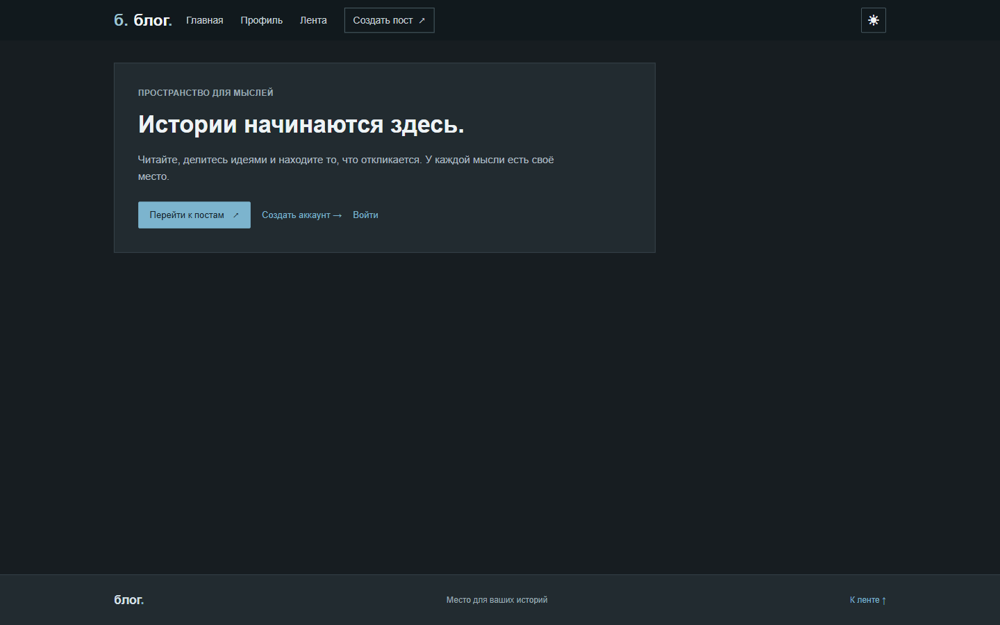
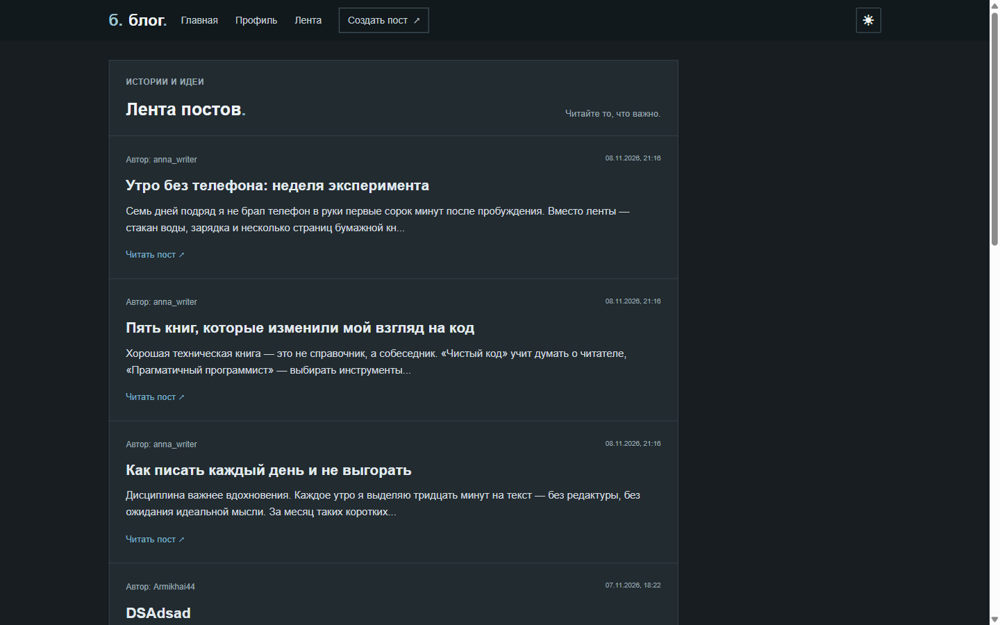
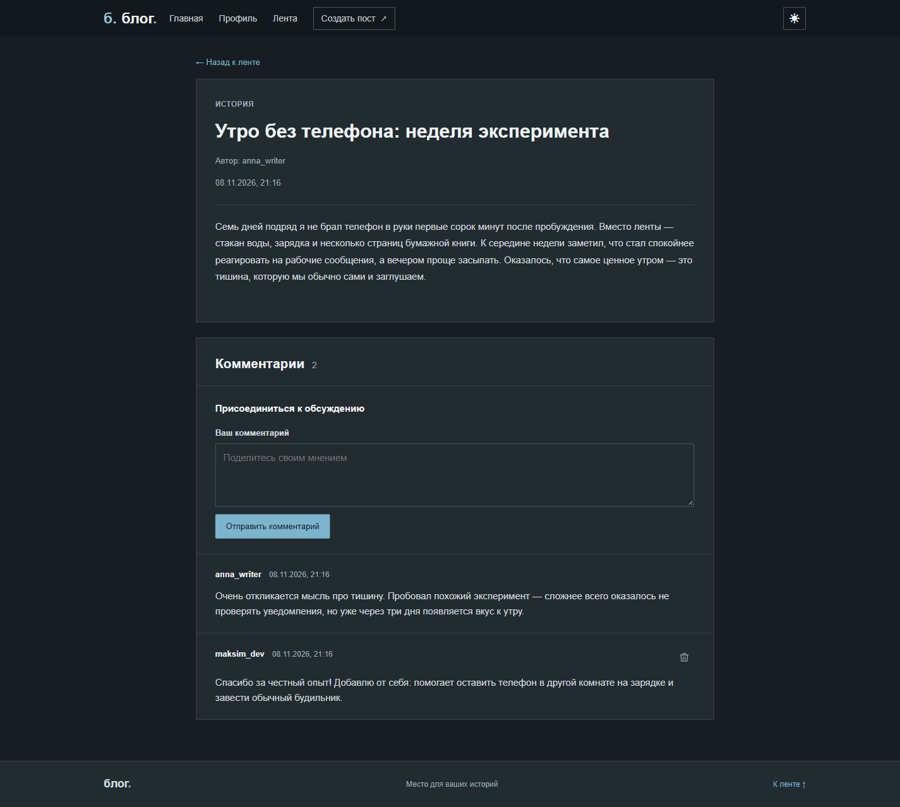
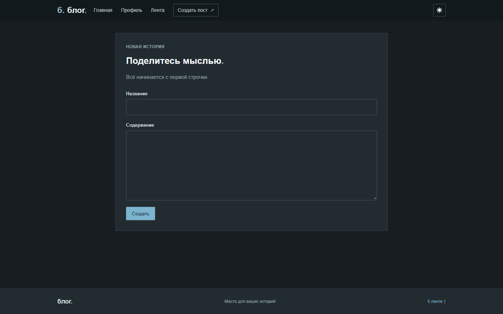
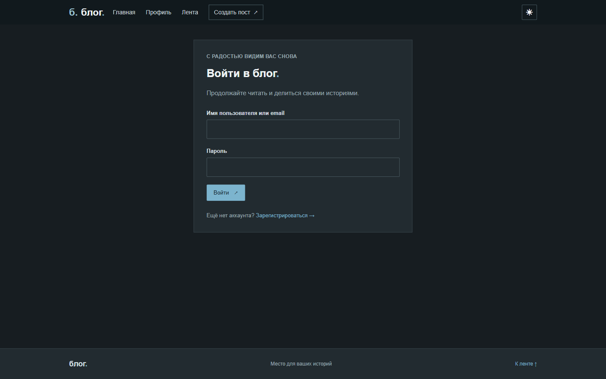
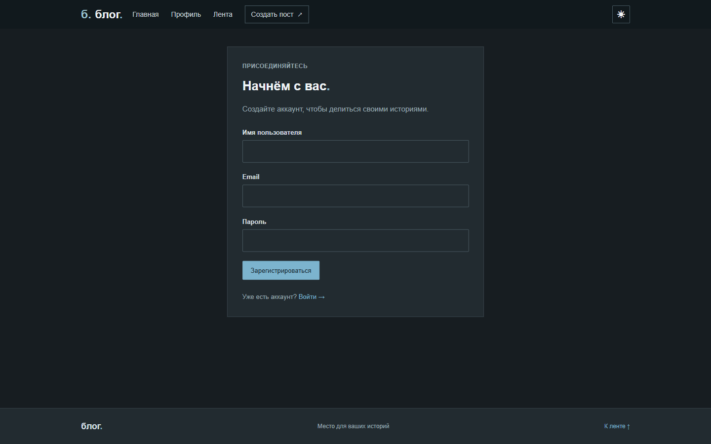
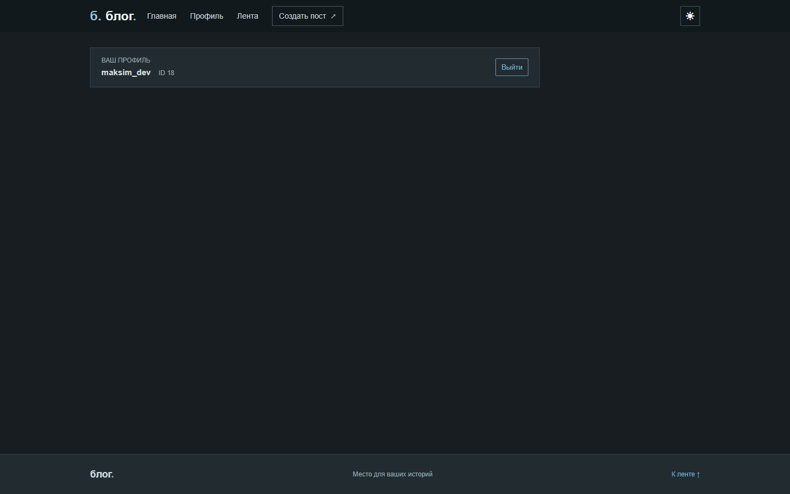
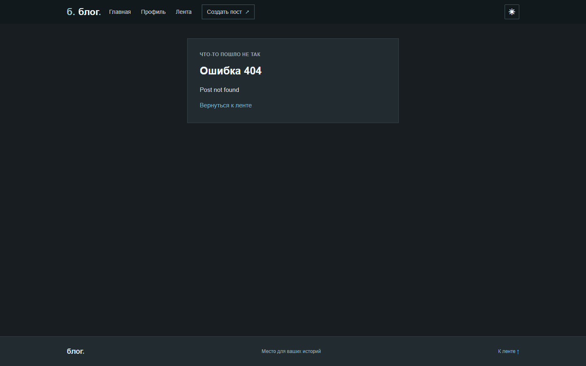
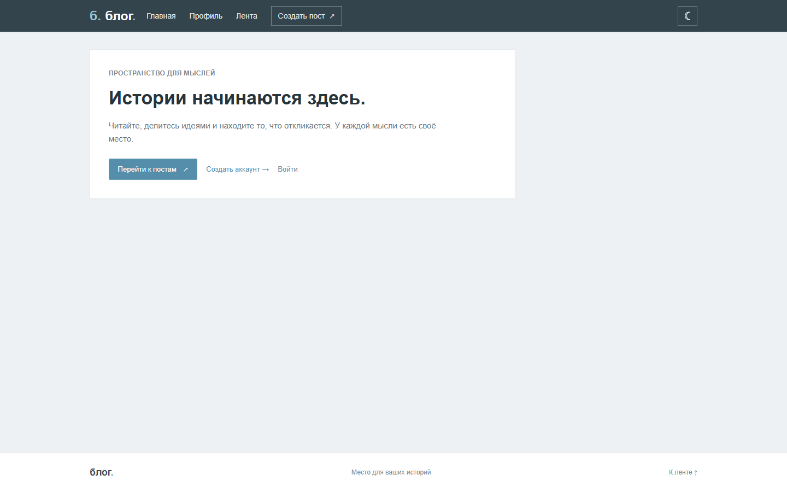

# блог.

Веб-блог на Spring Boot: пользователи регистрируются, публикуют посты и обсуждают их в комментариях.
Проект закрывает полный CRUD для постов и комментариев, разграничение прав (автор / администратор), пагинацию ленты, хранение сессий в PostgreSQL и переключение светлой и тёмной темы.
Код разделён на слои `controller → service → repository`, дополнен DTO, валидацией, централизованной обработкой ошибок и миграциями Flyway.

## Стек

| Технология | Версия / роль |
|---|---|
| Java | 21 |
| Spring Boot | 4.1.2 |
| Spring Web MVC | Серверный рендеринг страниц, обработка форм |
| Spring Data JPA (Hibernate) | Работа с сущностями и репозиториями |
| Spring Security | Аутентификация, авторизация, BCrypt, CSRF |
| Thymeleaf + `thymeleaf-extras-springsecurity6` | Шаблоны и проверка ролей во вьюшках |
| PostgreSQL | 16, основное хранилище |
| Flyway | Миграции схемы БД |
| Spring Session JDBC | Сессии в таблицах `SPRING_SESSION*` |
| Springdoc OpenAPI | 3.2.0, задел под документацию API |
| Lombok | Сокращение шаблонного кода |
| JUnit 5 + MockMvc + Testcontainers | Интеграционные тесты на реальном PostgreSQL |
| Maven | Сборка проекта |
| Docker Compose | Локальный запуск базы данных |

## Возможности

- Регистрация, вход и выход; пароли хранятся в виде BCrypt-хеша.
- Публикация постов, редактирование и удаление — только автором; администратор может удалять любые посты и комментарии.
- Комментарии к постам с ограничением длины и защитой от XSS (экранирование Thymeleaf).
- Лента с пагинацией: 10 постов на страницу, сортировка по дате создания (новые сверху).
- Две темы оформления (тёмная и светлая), выбор запоминается в cookie `theme`.
- Валидация форм на клиенте и на сервере, понятные страницы ошибок (404, 403 и др.).
- Сессии сохраняются в PostgreSQL, поэтому переживают перезапуск приложения.

## Ручки (HTTP endpoints)

| Метод | Путь | Доступ | Назначение |
|---|---|---|---|
| GET | `/` | все | Главная страница |
| POST | `/change-theme` | все | Переключение темы, сохраняет cookie `theme` |
| GET | `/auth/register` | все | Страница регистрации |
| POST | `/auth/register` | все | Создание аккаунта и автоматический вход |
| GET | `/auth/login` | все | Страница входа |
| POST | `/auth/login` | все | Вход по имени пользователя или email |
| GET | `/auth/profile` | все | Профиль текущего пользователя |
| POST | `/auth/logout` | все | Выход, инвалидация сессии |
| GET | `/posts` | все | Лента постов, параметры `page`, `size`, `sort` |
| GET | `/posts/{id}` | все | Страница поста с комментариями |
| GET | `/posts/create` | авторизованные | Форма создания поста |
| POST | `/posts` | авторизованные | Создание поста |
| PUT | `/posts/{id}` | автор | Обновление поста (форма с `_method=PUT`) |
| DELETE | `/posts/{id}` | автор, админ | Удаление поста |
| POST | `/comments/{postId}` | авторизованные | Добавление комментария к посту |
| DELETE | `/comments/{commentId}` | автор комментария, админ | Удаление комментария |

Публично доступны главная, регистрация, вход, лента и чтение отдельного поста; остальные запросы требуют аутентификации. Неверные данные и отсутствующие сущности обрабатываются через `GlobalExceptionHandler` и `AppErrorEnum` (404, 403, 409, 400).

## Вьюшки (Thymeleaf)

| Шаблон | Страница |
|---|---|
| `templates/index.html` | Главная с приветственным блоком |
| `templates/posts.html` | Лента постов с пагинацией |
| `templates/post.html` | Пост, редактирование, комментарии |
| `templates/post-create.html` | Создание нового поста |
| `templates/login.html` | Вход |
| `templates/register.html` | Регистрация |
| `templates/profile.html` | Профиль и выход |
| `templates/errors/app-error.html` | Страница ошибки |
| `templates/fragments/layout.html` | Общие шапка и подвал |

## Скриншоты

### Главная страница (тёмная тема)
Точка входа с навигацией, переключателем темы и кнопками перехода к ленте и регистрации.



### Лента постов
Карточки постов с автором, датой, кратким содержанием и ссылкой на чтение; снизу — постраничная навигация и счётчик.



### Страница поста
Полный текст, автор и дата, кнопки редактирования/удаления для владельца, форма добавления и список комментариев.



### Создание поста
Форма с названием и содержанием, доступна только авторизованным пользователям.



### Вход
Вход по имени пользователя или email с серверной валидацией полей.



### Регистрация
Проверка формата имени, email и пароля на клиенте и на сервере.



### Профиль
Имя, ID и роль пользователя, кнопка выхода.



### Обработка ошибок
Единая страница ошибки: например, 404 при запросе несуществующего поста.



### Светлая тема
Вторая тема оформления; выбор хранится в cookie и применяется на всех страницах.



## Запуск

### 1. База данных

```bash
docker compose up -d db
```

Поднимается PostgreSQL 16 на `localhost:5432` с базой `appdb`, пользователем `app` и паролем `secret` (см. `docker-compose.yaml`).

### 2. Приложение

```bash
./mvnw spring-boot:run
```

На Windows:

```powershell
.\mvnw.cmd spring-boot:run
```

Приложение будет доступно по адресу **http://localhost:8181**.

Параметры подключения можно переопределить переменными окружения `DB_USER` и `DB_PASSWORD`; остальные настройки — в `src/main/resources/application.yaml`. Схема БД создаётся миграциями Flyway при старте, Hibernate работает в режиме `ddl-auto: validate`.

### 3. Тесты

```bash
./mvnw test
```

Интеграционные тесты поднимают PostgreSQL через Testcontainers, поэтому требуется запущенный Docker.

## Структура проекта

```
src/main/java/ru/sfedu/blog
├── config        # Security, глобальная тема
├── controller    # Home, Auth, Post, Comment
├── dto           # Запросы и ответы
├── entity        # User, Post, Comment, UserRoleEnum
├── exception     # AppException, AppErrorEnum, GlobalExceptionHandler
├── repository    # Spring Data JPA + обёртки
├── security      # CustomUserDetails, CustomUserDetailsService
└── service       # Auth, Session, Post, Comment
src/main/resources
├── db/migration  # Flyway-миграции
├── static        # CSS и JS
└── templates     # Thymeleaf-вьюшки
```
